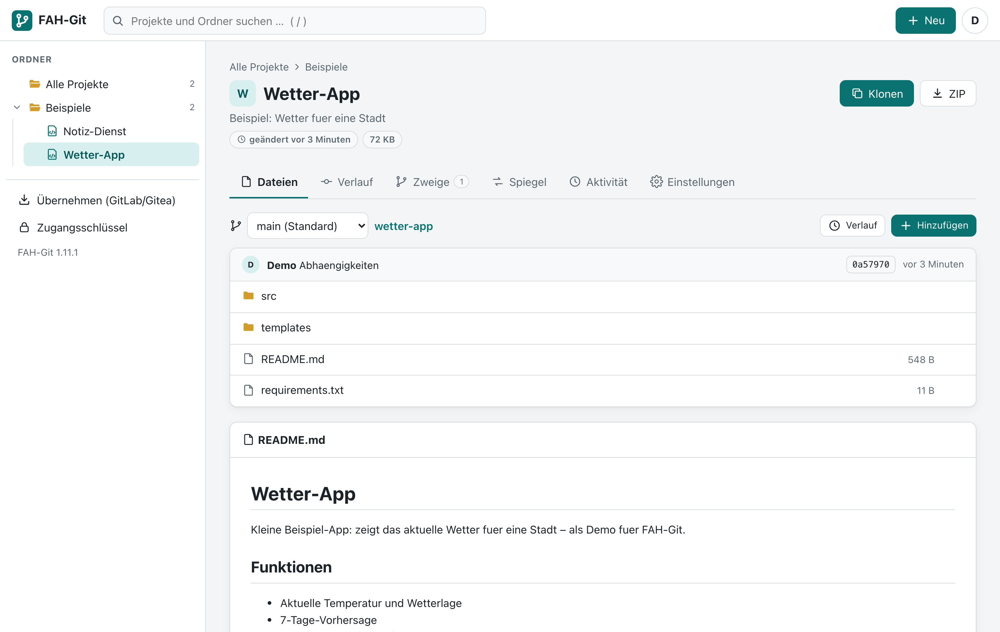
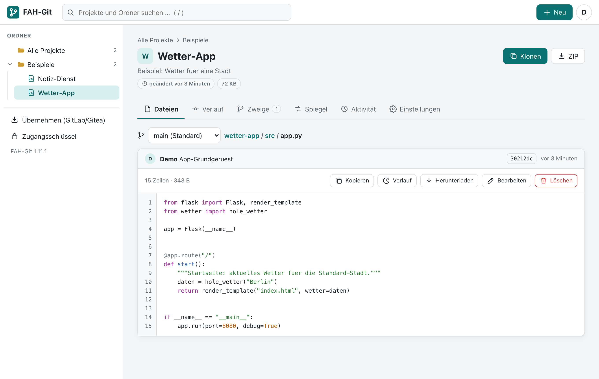
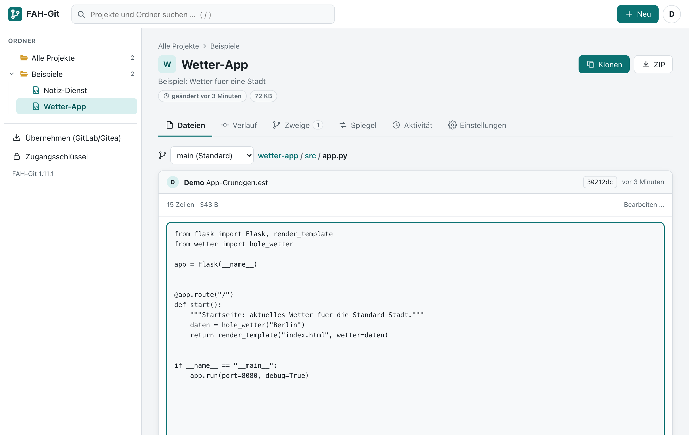

# FAH-Git

Schlanker Git-Server mit Ordnerbaum (beliebig tiefe Ordner wie GitLab-Gruppen), Code-Ansicht, Verlauf, Spiegeln an andere Gits
(nie überschreibend) und Übernahme aus GitLab oder Gitea. Ein Node-Prozess ohne Datenbank: Repos liegen als normale Git-Ordner
unter `daten/repos/`.

## So sieht es aus

Projekte durchstöbern – Ordnerbaum, Dateiliste und gerendertes README:

Quelltext mit Syntaxfarben und Zeilennummern, dazu Kopieren · Verlauf · Herunterladen · Bearbeiten · Löschen:

Textdateien direkt im Browser bearbeiten – „Bearbeiten“, tippen, speichern (ein Commit auf dem Zweig):

## Funktionen

- Installieren: FAH-NAS → Apps → ZIP-App → `fah-git_release.zip`. Danach im Browser das erste Konto anlegen.
- Aktualisieren: neue ZIP in FAH-NAS einspielen. `daten/` und `.env` bleiben.
- git: `git clone http://<nas>:3300/<ordner>/<projekt>.git` – als Kennwort einen Zugangsschlüssel aus „Mein Konto“.
- Im Browser schreiben (1.2.0): In der Dateiansicht „Hinzufügen“ → Neue Datei, Neuer Ordner (mit `.gitkeep`), Dateien oder
  ganze Ordner von der Festplatte hochladen – oder einfach aus dem Finder auf die Dateiliste ziehen. Jede Aktion ist ein Commit
  auf dem angezeigten Zweig (im leeren Projekt der erste). Kopien fremder Gits bleiben nur lesbar.
- Löschen (1.3.0): Papierkorb am Zeilenende der Dateiliste (Datei oder ganzer Ordner) oder „Löschen“ in der Dateiansicht –
  ein Commit mit optionaler Nachricht; im Verlauf bleibt alles erhalten.
- Seitenleiste (1.3.1): Breite am rechten Rand ziehen (200 px bis halbe Fensterbreite), Pfeiltasten am Griff, Doppelklick =
  Standard 280 px; wird im Browser gemerkt.
- Profilbild (1.4.0): „Mein Konto“ → Profilbild hochladen oder entfernen. Der Browser schneidet mittig quadratisch zu und
  verkleinert auf 256 × 256 (WebP/PNG, höchstens 300 KB); liegt unter `daten/avatare/`, nicht im Git. Erscheint oben rechts,
  in der Aktivität und in der Benutzerliste, sonst der Anfangsbuchstabe. Wandert beim Umbenennen mit, verschwindet beim Löschen.
- Zugangsschlüssel „Nur lesen“ (1.4.0): beim Anlegen wählbar (Standard bleibt „Lesen und schreiben“, alte Schlüssel ebenso).
  Darf per Schnittstelle nur GET/HEAD und per git nur klonen/holen; jede Änderung und jeder Push → 403. Richtig für FAH-NAS.
- Auf FAH-NAS bauen (1.4.0): Einstellungen → „FAH-NAS-Adresse“ (z. B. `https://nas.example:8443`, leer = aus). Dann hat jede
  Projektseite den Knopf „Auf FAH-NAS bauen“: öffnet `<adresse>/#/apps/fahgit/<projektpfad>/<zweig>` (beides kodiert) in
  einem neuen Tab; FAH-NAS baut dort `docker-compose.yml` bzw. `Dockerfile` des Projekts. FAH-NAS liest mit einem Schlüssel
  „Nur lesen“ – für alle Projekte von einem Admin-Konto angelegt (Schlüssel erben die Rechte ihres Nutzers).
- Rechte je Ordner/Projekt (1.4.0): Administratoren dürfen alles. Alle anderen sehen und dürfen nur, was ihnen unter
  „Benutzer verwalten“ → „Rechte“ freigegeben ist (Ordner oder Projekt, „Lesen“ oder „Lesen und schreiben“, gilt mit allem
  darunter). Neue und **bestehende** Nicht-Admin-Konten haben nach dem Update **keine** Freigaben und sehen nichts, bis ein
  Admin etwas freigibt. Nicht Freigegebenes antwortet mit 404; Verschieben, Umbenennen, Löschen von Projekten/Ordnern,
  Weiterleitungen, Kopien, Übernahme, Einstellungen und Benutzer bleiben Administratoren vorbehalten. Zugangsschlüssel
  erben die Rechte ihres Nutzers. Admins können Benutzer jetzt auch umbenennen (Schlüssel, Rechte und Bild gehen mit).
- Sicherung (1.5.0, nur Administratoren): Menü oben rechts → „Sicherung“. Der **ganze** Datenbestand – alle Repos samt
  Historie, Konten, Rechte, Zugangsschlüssel, Weiterleitungen/Quellen und der Schlüssel für Sitzungen und verschlüsselte
  Zugänge – als eine `.tar.gz`. „Jetzt sichern“ legt eine Sicherung in `daten/_backups` ab, „Herunterladen“ gibt sie als
  Datei; täglicher Automatik-Lauf mit einstellbarer Aufbewahrung. „Wiederherstellen“ spielt eine Datei wieder ein (vorher
  automatisch eine Sicherheitskopie des Ist-Standes), danach startet FAH-Git neu. Damit lässt sich der Server nach einem
  Seit 1.7.0 zeigt die Seite je Schritt (Packen, Kopie aufs NAS) einen Balken mit Restzeit, auch nach neuem Seitenaufruf;
  die Kachel in der Übersicht nennt die Prozent. Halbfertige Archive heißen `.…teil` und zählen nie als Sicherung.
  Totalschaden 1:1 zurückholen. Für off-box-Schutz den Datenordner zusätzlich in FAH-Sicherung aufnehmen.
- Releases (1.12.0): FAH-Git bindet einen Ordner mit fertigen Release-Dateien (ZIP, ISO, DMG, PDF …) **nur lesend** ein –
  in der `.env` `ABLAGE=<Ordner auf dem NAS>`, im Container `/ablage`. Reiter „Releases“ je Projekt: Admins ordnen Dateien
  aus der Ablage zu (Ordner durchklicken, ankreuzen) und wählen eine ZIP als „öffentlich“; alle mit Leserecht sehen Name,
  Größe und Stand und können herunterladen (ohne Pfade der Ablage). „Auf GitHub veröffentlichen“ schickt die öffentliche
  ZIP ohne Hochladen als Release zu GitHub (Version = Datum/Uhrzeit der Datei, z. B. `2026.11.27-0928`; ältere Releases
  und Tags werden danach entfernt).
  Schutz: Namen nach Schlüssel/Privatem („NICHT VERTEILEN“, „privat“, „Nur für …“, „API KEYS“, `.hex`, `.pem` …) sind
  gesperrt; keine Verweise/harten Links, Pfade bleiben in der Ablage. ZIPs werden über Inhaltsverzeichnis UND Dateiköpfe
  lückenlos gelesen; ZIPs mit Schlüssel- oder Zugangsdateien bzw. `.git`-Ordner lassen sich gar nicht zuordnen (`.env`-Vorlagen wie `.env.example` oder `.env.edeka.example` sind erlaubt, solange der Name auf die Vorlagen-Endung endet – 1.15.3). Vor dem
  Veröffentlichen sperren zusätzlich verschachtelte Archive und je Projekt verbotene Pfade (z. B. `lokale-stimme/`).
  Öffentlich kann eine ZIP sein (Inhalt geprüft) oder – seit 1.13.0 – eine andere Datei (z. B. Installer-ISO) mit Prüfvermerk
  des Bauskripts daneben (`<datei>.pruefung.json` mit `datei`, `groesse`, `sha256`, `werkzeug`): FAH-Git rechnet die
  Prüfsumme vor dem Hochladen nach. Eine ISO liest FAH-Git zusätzlich selbst (ISO 9660 mit Rock Ridge): alle Pfade, die
  eigenen Teile (`/fahnas`, `/nocloud`, GRUB-Menüs) und darin liegende `.tar.gz` (entpackt) gegen Schlüssel-Namen, die je
  Projekt verbotenen Pfade und die privaten Begriffe der GitHub-Bereinigung (Funde nennen nie den Begriff). Geprüft und
  hochgeladen wird aus demselben Dateigriff; ändert sich die Datei während des Hochladens, nimmt FAH-Git das Release zurück.
- Fail-over (1.14.0): Eine zweite Instanz (z. B. auf dem NAS) hält sich laufend auf dem Stand des Haupts. Am Ersatz in der
  `.env` `ROLLE=ersatz` setzen und starten – die Startseite fragt nach der Adresse des Haupts und dem Kopplungscode (am Haupt:
  Einstellungen → Fail-over → „Kopplungscode erzeugen“). Danach fragt der Ersatz alle 15 Sekunden nach und holt nur
  Geändertes: Projekte mit allen Zweigen und Tags (`git fetch`, Gelöschtes verschwindet), Ordner, Konten, Rechte,
  Zugangsschlüssel, Einstellungen, Aktivität und Profilbilder. Anmelden geht dort mit denselben Zugangsdaten; ändern, pushen,
  weiterleiten und sichern nicht (Antwort 423 bzw. git 403). Der Code geht nie übers Netz: Anfragen sind damit unterschrieben
  (Zeitfenster 2 Minuten, jeder Einmalwert nur einmal), Antworten mit AES-256-GCM verschlüsselt; für git gibt es
  kurzlebige Nur-Lese-Zugänge. Fällt der Haupt aus: am Ersatz Einstellungen → Fail-over → „Zum Haupt machen“ (später
  „Wieder Ersatz werden“). Meldet der Haupt keine Repos, löscht der Ersatz aus Vorsicht nichts. Kachel „Fail-over“ in der
  Übersicht zeigt, ob der Ersatz aktuell ist.
- Fail-over-Selbstupdate (1.15.0): Bekommt der Haupt eine neue Version (egal ob per FAH-NAS-Oberfläche oder Skript), zieht
  der Ersatz von allein nach. `tools/baue_zip.sh` unterschreibt jedes Release beim Bau (Ed25519, privater Schlüssel nur auf
  dem Bau-Rechner unter `~/.config/fah-git/release-schluessel.pem`; der öffentliche steht in `src/release-schluessel.txt`).
  Der Haupt reicht nur dieses unterschriebene Release weiter (`paket-manifest.txt`, `paket-signatur` in der ZIP) und kann
  selbst nichts unterschreiben. Der Ersatz prüft es und legt es bereit; auf seinem Rechner prüft `./manage.sh auto-update`
  (alle 2 Minuten vom Compose-Dienst `updater` gestartet – Profil `ersatz`, das manage.sh nur bei `ROLLE=ersatz` einschaltet, auf dem Haupt läuft er nie; ohne Netz, nur Docker und dieser App-Ordner; `./manage.sh update` baut und startet ihn mit, `./manage.sh zeitplan` richtet nur ihn neu ein) noch einmal mit dem
  Schlüssel und Prüfcode der installierten Fassung – in Wegwerf-Containern ohne Netz, auf einer Kopie, die der Container nicht
  erreicht. Nur neuere Versionen; das neue Abbild wird zuerst gebaut, startet die neue Fassung nicht, geht es auf die alte
  zurück. Abgelehnte Pakete werden nicht erneut versucht (`.update-abgelehnt`). Der Ersatz zeigt sich am Haupt mit seiner
  Adresse (`ADRESSE=` in seiner `.env`). Geht der Release-Schlüssel verloren, einmal von Hand aktualisieren.
- Im Browser bearbeiten (1.11.0): In der Dateiansicht einer Textdatei „Bearbeiten“ → Editor-Textfeld (Tab fügt einen
  Tabulator ein, Cmd/Strg+S speichert). Speichern legt einen Commit auf den Zweig; eine zwischenzeitliche Änderung wird
  erkannt und nicht überschrieben. Nur mit Schreibrecht, nicht in nur-lesbaren Kopien.
